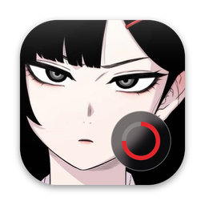
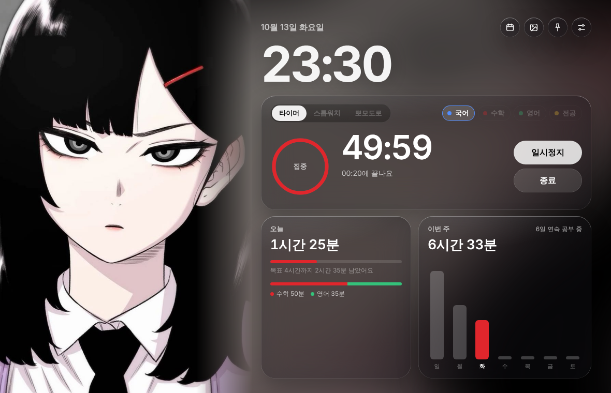
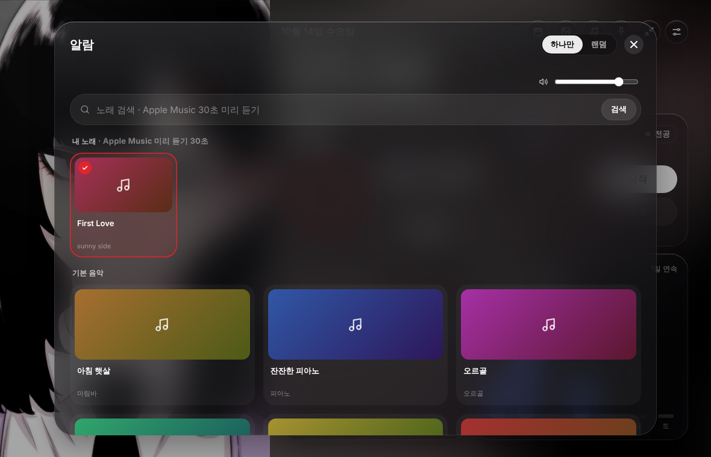
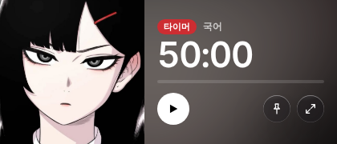
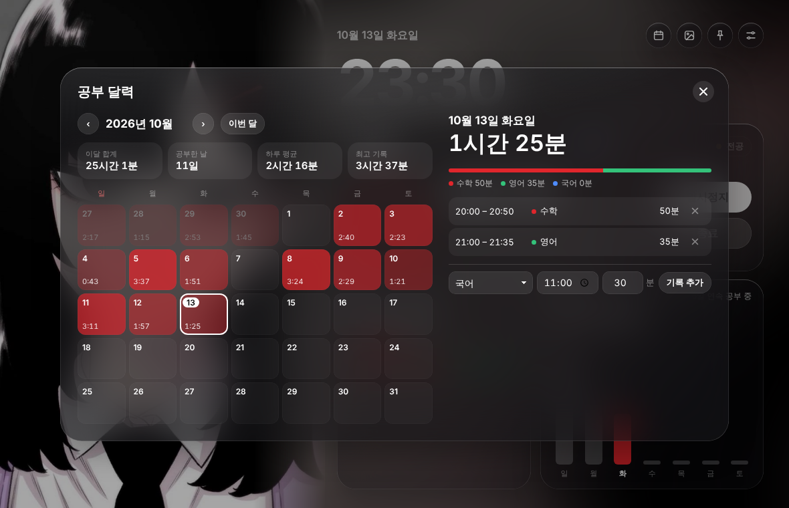
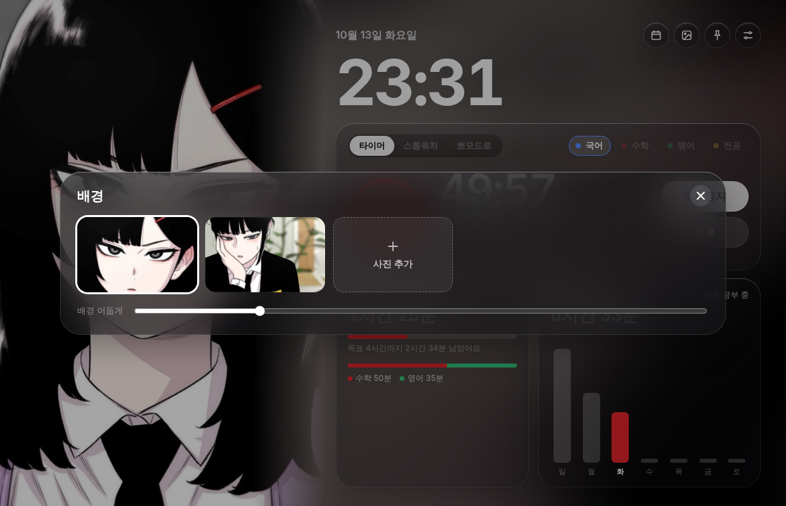
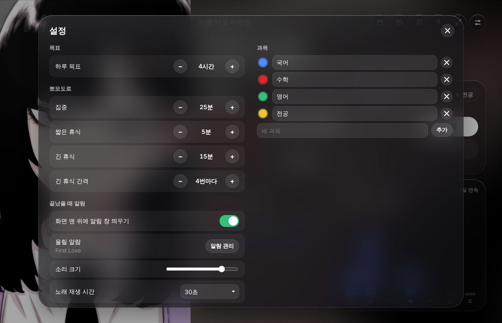

# 타이머 앱 v2



좋아하는 캐릭터를 배경으로 띄워 두고 공부 시간을 재는 macOS용 공부 타이머예요.
공부한 시간은 날짜와 과목별로 저장되고, 달력과 주간 그래프로 볼 수 있어요.
시간이 다 되면 화면 맨 위에 알림 창이 뜨고, 고른 노래가 울려요.



> 스크린샷의 기록은 예시 데이터예요. 처음 설치하면 0분부터 시작해요.
> v1에서 무엇이 왜 바뀌었는지는 [CHANGELOG.md](CHANGELOG.md)에 정리했어요.

---

## 목차

1. [설치하기](#설치하기)
2. [화면 구성](#화면-구성)
3. [타이머 쓰기](#타이머-쓰기)
4. [과목 고르기](#과목-고르기)
5. [끝났을 때 알림](#끝났을-때-알림)
6. [알람 소리 고르기](#알람-소리-고르기)
7. [간소화 모드](#간소화-모드)
8. [기록과 달력](#기록과-달력)
9. [배경 바꾸기](#배경-바꾸기)
10. [설정](#설정)
11. [단축키](#단축키)
12. [기록은 어디에 저장되나요](#기록은-어디에-저장되나요)
13. [자주 묻는 질문](#자주-묻는-질문)

---

## 설치하기

필요한 것: macOS 11(Big Sur) 이상, Xcode 또는 Xcode 명령줄 도구.

1. 이 저장소를 내려받아요.
   ```bash
   git clone https://github.com/kimkh0118/study-timer.git
   cd study-timer
   ```
2. 명령줄 도구가 없다면 한 번만 설치해요. (Xcode가 이미 깔려 있으면 건너뛰어요.)
   ```bash
   xcode-select --install
   ```
3. 빌드하고 바탕화면에 설치해요.
   ```bash
   ./build.sh --install
   ```
   터미널이 익숙하지 않다면 Finder에서 `build.command`를 더블클릭해도 같아요.

바탕화면에 **캐릭터 타이머** 앱이 생기고 바로 실행돼요. 다음부터는 이 아이콘을 더블클릭하면 돼요.
Dock에 계속 두고 싶으면 실행 중에 Dock 아이콘을 우클릭하고 **옵션 → Dock에 유지**를 고르세요.

v1을 쓰던 중이라면 같은 방법으로 다시 빌드하면 돼요. 기록과 설정은 그대로 남아요.

자세한 빌드 과정과 구조는 [make.md](make.md)에 있어요.

---

## 화면 구성

| 위치 | 내용 |
|---|---|
| 왼쪽 | 배경 캐릭터. 사진 비율과 상관없이 왼쪽 칸 크기는 항상 같아요. |
| 오른쪽 위 | 오늘 날짜와 현재 시각, 버튼 여섯 개 |
| 가운데 카드 | 타이머. 방식 선택, 과목 선택, 남은 시간, 시작·종료 버튼 |
| 아래 왼쪽 | **오늘**: 오늘 공부한 시간, 하루 목표까지 남은 시간, 과목별 색 막대 |
| 아래 오른쪽 | **이번 주**: 일요일부터 토요일까지 요일별 막대, 연속 공부일 |

오른쪽 위 버튼 (왼쪽부터):

| 버튼 | 하는 일 |
|---|---|
| 달력 | 날짜별 기록 보기, 기록 지우기·직접 넣기 |
| 배경 | 배경 사진 바꾸기·추가하기 |
| 음표 | 알람 소리 고르기 |
| 압정 | 항상 위에 띄우기 켜기/끄기 |
| 화살표 | 간소화 모드 (작은 창) |
| 가로줄 | 설정 |

막대 색의 뜻:

- 빨강: 오늘, 또는 진행 중인 집중 시간
- 노랑: 하루 목표를 채운 날
- 회색: 지난 날

---

## 타이머 쓰기

가운데 카드 왼쪽 위에서 방식을 골라요. 타이머가 돌아가는 동안에는 방식과 과목을 바꿀 수 없어요.

### 타이머

정해 둔 시간만큼 집중해요.

- `25분` `50분` `90분` 버튼으로 바로 고르거나, `−` `+`로 5분씩 조절해요(5분~300분).
- **시작**을 누르면 링이 줄어들고, 끝나는 시각이 아래에 나와요.
- 시간이 다 되면 알림 창이 뜨고 알람이 울려요. 공부한 시간은 자동으로 기록돼요.
- 중간에 **종료**를 누르면 그때까지 공부한 시간만 기록돼요.

### 스톱워치

정해진 시간 없이 공부한 만큼 재요.

- **시작**을 누르면 0부터 올라가요. 링은 오늘 목표를 얼마나 채웠는지 보여 줘요.
- 다 했으면 **종료**를 눌러요. 그때 기록돼요.

### 뽀모도로

집중과 휴식을 번갈아 해요.

- 기본값: 25분 집중 → 5분 휴식, 4번째마다 15분 긴 휴식.
- 집중이 끝나면 휴식이 자동으로 시작돼요. 휴식이 끝나면 알림 창의 **집중 시작**을 누르거나 직접 **시작**을 눌러요.
- 빨간 점은 이번 묶음에서 끝낸 집중 횟수예요.
- 휴식 중에는 **휴식 건너뛰기**로 바로 넘어갈 수 있어요.
- 휴식 시간은 공부 시간에 들어가지 않아요.

### 기록 규칙

- 1분이 안 되는 공부는 기록하지 않아요.
- **일시정지**한 시간은 공부 시간에서 빠져요.
- 타이머를 켜 둔 채 앱이 꺼져도 괜찮아요. 20초마다 중간 저장을 해 두기 때문에, 다음에 열면 그때까지 공부한 시간이 기록에 들어가요.
- 자정을 넘긴 공부는 **시작한 날짜**에 기록돼요.

---

## 과목 고르기

타이머 카드 오른쪽 위의 과목 버튼을 눌러 지금 공부할 과목을 골라요. 과목이 많아 한 줄에 다 안 들어가면 **+N** 버튼을 눌러 전체 목록에서 골라요. 기록은 과목별로 따로 모여서, 오늘 카드와 달력에 색 막대로 보여요.

기본 과목은 국어, 수학, 영어, 전공이에요. 바꾸는 방법은 [설정](#설정)을 보세요.

---

## 끝났을 때 알림

시간이 다 되면 **화면 맨 위 가운데**에 알림 창이 떠요. 다른 앱을 쓰고 있거나 전체 화면이어도 그 위에 떠요.

| 상황 | 알림 창 내용 | 버튼 |
|---|---|---|
| 타이머 끝 | 수학 50분 집중했어요 / 오늘 2시간 30분 · 목표까지 1시간 30분 | 확인, 5분 더 |
| 뽀모도로 집중 끝 | 수학 25분 집중했어요 / 이제 5분 쉬어요 | 확인, 휴식 건너뛰기 |
| 뽀모도로 휴식 끝 | 2번째 집중을 시작할까요? | 집중 시작, 나중에 |

- 왼쪽에는 지금 배경 캐릭터가, 아래에는 울리는 노래 제목(♪)이 나와요.
- `Return`은 첫 번째 버튼, `Esc`는 닫기예요.
- 알람은 [설정](#설정)의 **노래 재생 시간**(30초·1분·3분·확인 누를 때까지)만큼 울리고 서서히 작아져요.
- 알림 창이 필요 없으면 설정에서 **화면 맨 위에 알림 창 띄우기**를 끄세요. 그래도 소리와 Dock 아이콘 튀기기는 그대로 돼요.

---

## 알람 소리 고르기

오른쪽 위 **음표** 버튼을 눌러요.



알람으로 쓸 수 있는 소리는 세 종류예요.

| 종류 | 설명 |
|---|---|
| **내 노래** | Apple Music에서 검색한 노래의 공식 미리 듣기(30초). 울리는 동안 반복해요. 인터넷이 필요해요. |
| **기본 음악** | 이 앱용으로 직접 만든 음악 6곡(아침 햇살, 잔잔한 피아노, 오르골, 상쾌한 기상, 종소리, 디지털 알람). 인터넷 없이 돼요. |
| **효과음** | Mac 기본 효과음 14개(Glass, Ping 등) |

### 노래 추가하기

1. 맨 위 검색칸에 노래 제목이나 가수를 쓰고 **검색**을 눌러요.
2. 앨범 그림을 누르면 30초 미리 듣기가 나와요. 한 번 더 누르면 멈춰요.
3. 마음에 들면 **추가**를 눌러요. **내 노래**에 들어가고, 바로 알람으로 골라져요.

- 미리 듣기 구간(곡의 어느 부분 30초인지)은 Apple이 정해 둔 거라 바꿀 수 없어요.
- 내 노래 칸 오른쪽 위 **×**로 지울 수 있어요.
- 인터넷이 끊겨 있어서 노래를 못 불러오면, 알람은 기본 효과음(Glass)으로 대신 울려요.

### 하나만 / 랜덤

알람 창 오른쪽 위에서 골라요.

- **하나만**: 칸을 누르면 그 소리 하나로 정해져요. 빨간 체크가 붙어요.
- **랜덤**: 여러 칸을 눌러 목록을 만들어요. 울릴 때마다 그 목록 안에서 하나를 골라요(바로 전에 울린 소리는 되도록 피해요). 아무것도 안 고르면 '아침 햇살'이 울려요.

### 소리 크기

알람 창 위쪽이나 설정의 **소리 크기** 막대를 움직이면, 지금 고른 알람이 실제로 나오면서 크기를 맞출 수 있어요. 랜덤이면 랜덤 목록 중 하나가 나와요. 손을 떼고 2초쯤 지나면 서서히 꺼져요.
막대를 맨 왼쪽까지 내리면 소리가 완전히 꺼져요.

---

## 간소화 모드

오른쪽 위 **화살표** 버튼을 누르면 창이 화면 오른쪽 위의 작은 창(420×180)으로 바뀌어요.



- 캐릭터, 남은 시간, 진행 막대, 시작/일시정지, 항상 위, 원래 크기 버튼만 보여요. 배경 색·밝기·투명도는 큰 창과 똑같아요.
- 시간 옆 배지로 지금 방식을 알려 줘요: **타이머**, **스톱워치**, **뽀모도로 2/4**(휴식 중엔 회색).
- 압정(항상 위에)을 켜 두면 간소화 창이 다른 창보다 항상 위에 있고 데스크탑(Space)을 바꿔도 따라와요. 끄면 보통 창처럼 다른 창을 누르면 그 뒤로 가요. **아무 곳이나 눌러 끌면** 원하는 자리로 옮길 수 있고, 다음에 간소화할 때도 그 자리에 떠요. (그냥 누르면 버튼이 평소처럼 눌려요)
- 오른쪽 아래 버튼을 누르면 원래 크기와 위치로 돌아가요.

---

## 기록과 달력

오른쪽 위 **달력** 버튼을 눌러요.



- **왼쪽 달력**: 공부를 많이 한 날일수록 진한 빨강이에요. 칸 아래 숫자는 `시간:분`이고, 목표를 채운 날엔 노란 점이 찍혀요.
- **위쪽 요약**: 이달 합계, 공부한 날 수, 하루 평균(공부한 날 기준), 최고 기록.
- **‹ ›** 로 달을 넘기고, **이번 달**로 돌아와요.
- **날짜를 누르면** 오른쪽에 그날 기록이 시간순으로 나와요.

### 기록 지우기

기록 오른쪽 **×**를 누르면 "지울까요?"가 나와요. **지우기**를 한 번 더 눌러야 지워져요.

### 기록 직접 넣기

타이머를 깜빡하고 공부했을 때 써요.

1. 달력에서 날짜를 골라요.
2. 아래쪽에서 과목, 시작 시각, 공부한 분을 넣어요.
3. **기록 추가**를 눌러요.

직접 넣은 기록은 내보낼 때 "직접 입력"으로 표시돼요.

---

## 배경 바꾸기

오른쪽 위 **배경** 버튼을 눌러요.



- 사진을 누르면 바로 바뀌어요.
- **사진 추가**를 누르고 사진을 고르면 추가돼요. 여러 장을 한 번에 고를 수 있어요. JPG, PNG, HEIC 모두 돼요.
- 직접 추가한 사진은 오른쪽 위 **×**로 지울 수 있어요. 기본 사진 두 장은 지워지지 않아요.
- **배경 밝기** 막대로 배경을 어둡게(30%)~원래대로(100%) 조절해요.
- **배경 투명도**: 0%~90%. 올릴수록 오른쪽 배경이 투명해져서 뒤의 바탕화면이 흐리게 비쳐 보여요(왼쪽 사진은 그대로).
- **오른쪽 배경 색**: 동그라미를 눌러 타이머 쪽 배경 색을 바꿔요. 첫 번째(사진에서)는 사진을 흐리게 깔아요. 맨 끝 **+**를 누르면 색 고르기 창(기본 팔레트 · 더 많은 색 격자 · 직접 고르기…)이 떠서 원하는 색을 추가할 수 있고(최대 8개), 추가한 색은 마우스를 올리면 나오는 ×로 지워요. 색은 무채색 · 진한 색 · 선명한 색 · 파스텔 네 줄, 모두 44색이에요.
- **글씨 색**: 자동 / 흰 글씨 / 검정 글씨. 자동이면 밝은 배경에서 검정 글씨로 바뀌어요(간소화 창도 같이).
- **위치 맞추기**를 누르면 왼쪽 사진에 흰 테두리가 생겨요. 사진을 끌어서 보이는 부분을 정하고 **완료**(또는 `Esc`)를 눌러요. **처음대로**는 원래 위치로 되돌려요. 위치는 사진마다 따로 저장되고, 간소화 창과 알림 창 그림에도 똑같이 적용돼요.
- 사진 크기나 비율에 제한은 없어요. 아주 큰 사진은 추가할 때 자동으로 줄여서 저장해요.

---

## 설정

오른쪽 위 **설정** 버튼(가로줄 두 개)을 눌러요.



| 항목 | 설명 | 범위 |
|---|---|---|
| 하루 목표 | 오늘 카드, 주간 막대, 달력 색, 알림 문구의 기준 | 30분~12시간, 30분 단위 |
| 집중 | 뽀모도로 집중 시간 | 5~120분 |
| 짧은 휴식 | 뽀모도로 휴식 | 1~30분 |
| 긴 휴식 | 묶음이 끝날 때 쉬는 시간 | 5~60분 |
| 긴 휴식 간격 | 몇 번 집중하면 긴 휴식인지 | 2~8번 |
| 화면 맨 위에 알림 창 띄우기 | 끝났을 때 알림 창 켜기/끄기 | |
| 울릴 알람 | 지금 고른 알람. **알람 관리**로 알람 창 열기 | |
| 소리 크기 | 알람 크기. 움직이면 고른 알람으로 들려줘요 | 0(무음)~100% |
| 노래 재생 시간 | 알람이 울리는 시간 | 30초, 1분, 3분, 확인 누를 때까지 |
| 내보내기 | 모든 기록을 CSV 파일로 저장 | |

### 과목 관리

- 이름 칸을 눌러 바로 고쳐요(최대 12자).
- 왼쪽 색 동그라미를 누르면 색 고르기 창이 떠요(기본 팔레트 · 더 많은 색 · 직접 고르기…). 새 과목은 다른 과목과 겹치지 않는 색이 자동으로 정해져요.
- **×**로 과목을 지워도 지난 기록은 남아요. 달력에는 "삭제된 과목"으로 보여요.
- 아래 칸에 이름을 쓰고 **추가**를 누르면 새 과목이 생겨요.

### 항상 위에 띄우기

오른쪽 위 **압정** 버튼을 누르면 다른 창을 열어도 타이머가 위에 떠 있어요. 다른 앱이 전체 화면이어도 그 위에 보이고, 데스크탑(Space)을 바꿔도 따라와요. 인강을 보면서 쓸 때 편해요. 한 번 더 누르면 꺼져요.

---

## 단축키

| 키 | 동작 |
|---|---|
| `Space` | 시작 / 일시정지 / 계속 |
| `Esc` | 열린 창(달력, 배경, 알람, 설정)이나 알림 창 닫기 |
| `Return` | 알림 창의 첫 번째 버튼 |
| `⌘ 0` | 숨긴 타이머 창 다시 보기 |
| `⌘ W` | 창 닫기 (앱은 계속 돌아가요. Dock 아이콘을 누르면 다시 열려요) |
| `⌘ Q` | 앱 끝내기 |
| `⌘ H` | 앱 숨기기 |
| `⌘ M` | 창 최소화 |

창 맨 위 띠를 잡고 끌면 창이 움직이고, 두 번 누르면 창이 커져요. (간소화 창은 아무 곳이나 끌어서 옮겨요.)
타이머가 도는 동안 Dock 아이콘에 남은 분이 숫자로 떠요.

---

## 기록은 어디에 저장되나요

```
~/Library/Application Support/CharacterTimer/
├── data.json          ← 모든 기록과 설정, 내 노래 목록
├── data.backup.json   ← 앱을 열 때마다 만드는 바로 전 백업
└── Wallpapers/        ← 직접 추가한 배경 사진
```

- 앱을 지우거나 다시 빌드해도 이 폴더는 그대로라서 기록이 남아요.
- 다른 Mac으로 옮기려면 이 폴더를 통째로 복사하면 돼요.
- `data.json`이 망가지면 앱이 자동으로 `data.broken-숫자.json`으로 옮겨 두고 백업에서 불러와요.
- 내 노래는 노래 파일이 아니라 Apple 미리 듣기 주소만 저장해요.

### 엑셀로 보기

설정 → **내보내기**를 누르면 CSV 파일이 저장돼요. 엑셀이나 Numbers에서 바로 열 수 있고, 한글도 깨지지 않아요.

| 날짜 | 시작 | 끝 | 과목 | 공부 시간(분) | 직접 입력 |
|---|---|---|---|---|---|
| 2026-10-14 | 20:00 | 20:50 | 수학 | 50 | |

---

## 자주 묻는 질문

**"확인되지 않은 개발자" 경고가 떠요.**
앱 아이콘을 우클릭 → **열기** → **열기**를 한 번 눌러 주세요. 그다음부터는 더블클릭으로 열려요. `build.sh`로 직접 빌드했다면 보통 이 경고는 안 떠요.

**끝났는데 소리가 안 나요.**
설정의 소리 크기가 맨 왼쪽(무음)이 아닌지, Mac 소리가 꺼져 있지 않은지 확인하세요. 내 노래로 골랐다면 인터넷이 연결돼 있어야 해요(끊겨 있으면 Glass 효과음이 대신 울려요).

**노래 검색이 안 돼요.**
인터넷 연결을 확인하세요. 검색은 한국·미국·일본 Apple 스토어에서 같이 찾아요. 아주 최근 곡이나 Apple Music에 없는 곡은 안 나올 수 있어요.

**노래를 1분이나 원하는 부분으로 울리고 싶어요.**
Apple이 무료로 제공하는 미리 듣기는 30초짜리 한 구간뿐이라 길이와 구간을 바꿀 수 없어요. 그 30초를 알람이 울리는 동안 반복해요. 이유는 [CHANGELOG.md](CHANGELOG.md)에 있어요.

**창을 가려 두면 시간이 틀려지나요?**
아니요. 남은 시간은 "언제 끝나는지"를 기준으로 계산하고, 끝나는 순간에는 Mac 쪽에서 화면을 깨워요. 다른 창 뒤에 있어도 정확해요.

**창을 닫았더니 타이머가 멈췄나요?**
아니요. 창을 닫아도 앱은 계속 돌아가고 알람도 울려요. Dock 아이콘을 누르거나 `⌘ 0`으로 다시 열어요. 완전히 끄려면 `⌘ Q`예요.

**기록을 실수로 지웠어요.**
앱을 끄고 `data.backup.json`을 `data.json`으로 이름을 바꾸면 이번에 앱을 열었을 때의 상태로 돌아가요.

**창이 작아서 버튼이 두 줄이 돼요.**
창 크기를 키우면 한 줄로 돌아와요. 가장 작게 줄일 수 있는 크기는 1000×680이에요.

---

## 버전

- **v2.05** (2026-10-14): 색 고르기 창(기본 팔레트 + 더 많은 색 격자 + Mac 색상 패널), 배경 색 `+`·과목 색에 같이 사용.
- **v2.04** (2026-10-14): 글씨 색(자동/흰 글씨/검정 글씨, 밝은 배경이면 자동으로 검정), 배경 색 44색.
- **v2.03** (2026-10-14): 간소화 창 끌어서 옮기기, 압정(항상 위에)을 따르는 창 층, 압정을 켜면 다른 앱 전체 화면 위에도 표시.
- **v2.01** (2026-10-14): 배경 위치 맞추기, 사진/화면 깔끔하게 나누기, 오른쪽 배경 색(내 색 추가), 배경 밝기·투명도, 달력 창 크기 고정, `−` `+` 한 묶음, 과목 +N 더보기·과목 색 직접 고르기, 간소화 창 끌어서 옮기기·배경 반영, 시작/일시정지 씹힘·화면 밀림·목록 가림 수정.
- **v2.0** (2026-10-14): 끝났을 때 맨 위 알림 창, 알람 소리 고르기(Apple Music 미리 듣기·기본 음악·효과음, 하나만/랜덤), 들으며 소리 크기 맞추기, 간소화 모드, 켜질 때 모션, 배경 크기 안정화. 자세한 내용과 바뀐 이유는 [CHANGELOG.md](CHANGELOG.md).
- **v1** (2026-10-13): 첫 버전. 타이머·스톱워치·뽀모도로, 날짜·과목별 기록, 달력, 주간 통계, 배경 관리, 항상 위에, CSV 내보내기.

## 저작권 안내

- 기본 배경(`app/Resources/wallpapers/`)과 앱 아이콘은 웹툰 『별이삼삼』 장면을 쓴 개인용 팬아트예요. 이 저장소는 비공개로, 개인 사용 목적으로만 둬요. 공개하거나 배포하려면 이 이미지들을 빼고 직접 찍거나 그린 사진으로 바꿔 주세요.
- 기본 음악 6곡(`app/Resources/sounds/`)은 `tools/`의 스크립트로 직접 만든 곡이라 저작권 걱정 없이 써도 돼요.
- 내 노래의 미리 듣기는 Apple이 제공하는 공식 미리 듣기 주소를 그대로 재생해요. 노래 파일을 내려받아 저장하지 않아요.
